

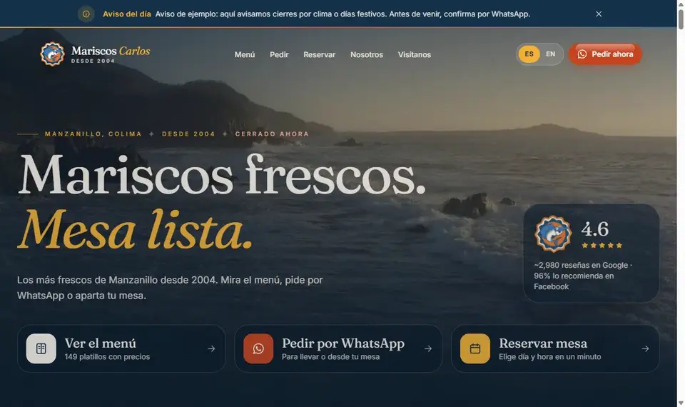

<h1>Mariscos Carlos</h1>

<b>Mariscos frescos. Mesa lista.</b> 
Sitio y sistema de pedidos para una marisquería de Manzanillo, Colima.

  

 

> Una propuesta para que el restaurante tenga su carta, sus pedidos y sus reservaciones en un solo lugar: el cliente pide desde la mesa o por WhatsApp, y la cocina lo ve al instante.

 

## ✦ Lo que hace

<table>
  <tr>
    <td width="33%" valign="top"><b>Menú que se hojea</b> Los 149 platillos de la carta real, en páginas que se abren como libro, con buscador.</td>
    <td width="33%" valign="top"><b>Comanda por WhatsApp</b> El carrito arma el pedido y le llega al restaurante listo para leer.</td>
    <td width="33%" valign="top"><b>Reservaciones</b> Día, hora y número de personas en un minuto.</td>
  </tr>
  <tr>
    <td valign="top"><b>Pedido desde la mesa</b> Cada mesa tiene su QR: el pedido llega con su número.</td>
    <td valign="top"><b>Mesero y cocina</b> Un tablero en vivo: pendiente, en preparación, listo.</td>
    <td valign="top"><b>Español e inglés</b> Con un botón, para los turistas.</td>
  </tr>
</table>

 

## ✦ La carta, como libro

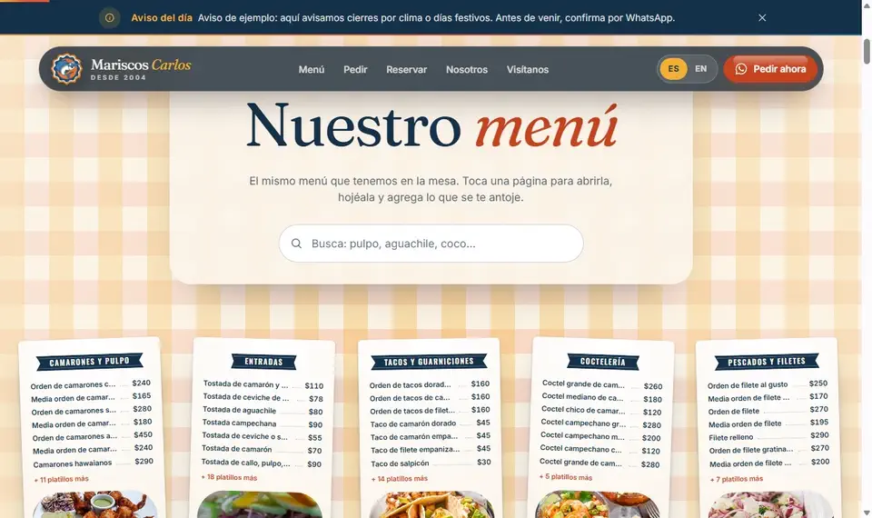

 

## ✦ Pantallas

<table>
  <tr>
    <td width="50%">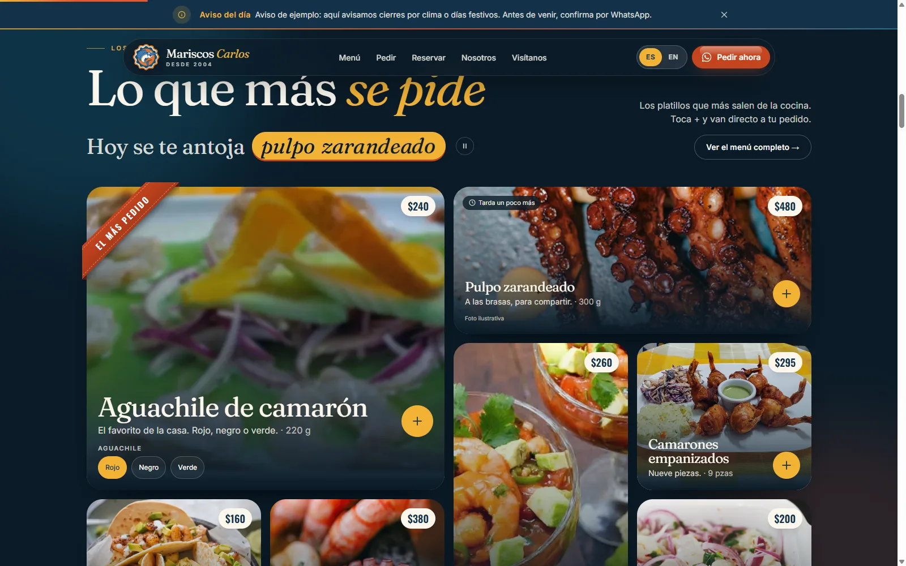
Lo que más se pide
</td>
    <td width="50%">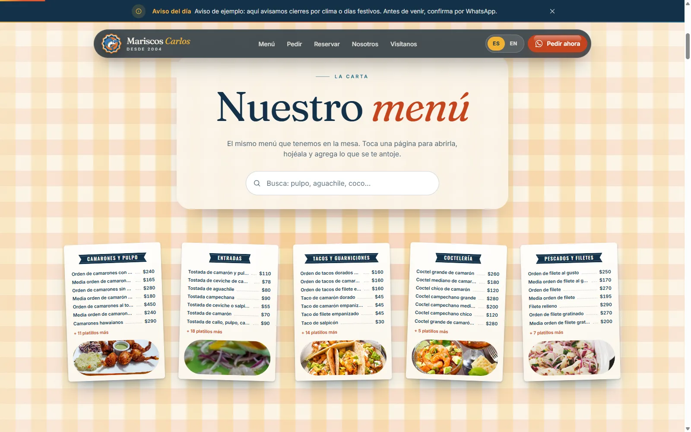
La carta por páginas
</td>
  </tr>
  <tr>
    <td>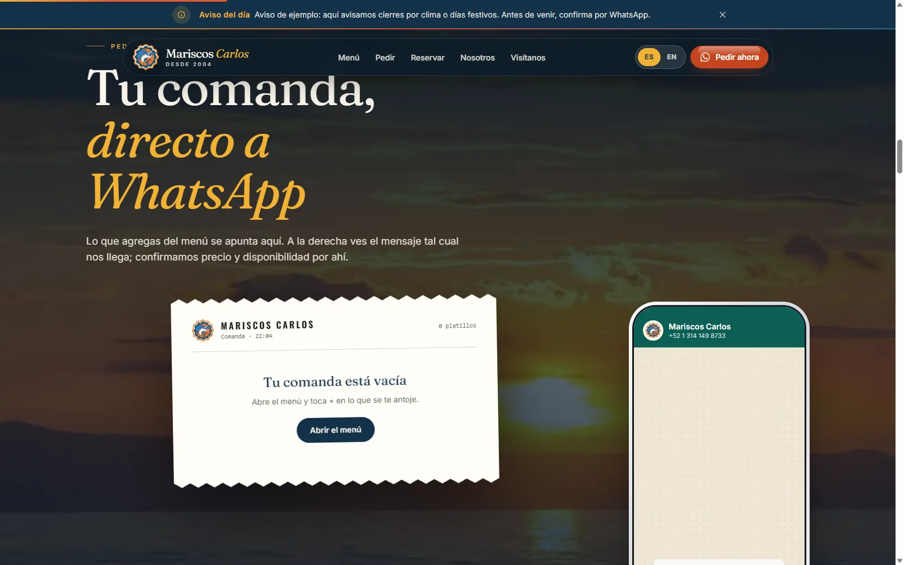
Tu comanda, directo a WhatsApp
</td>
    <td>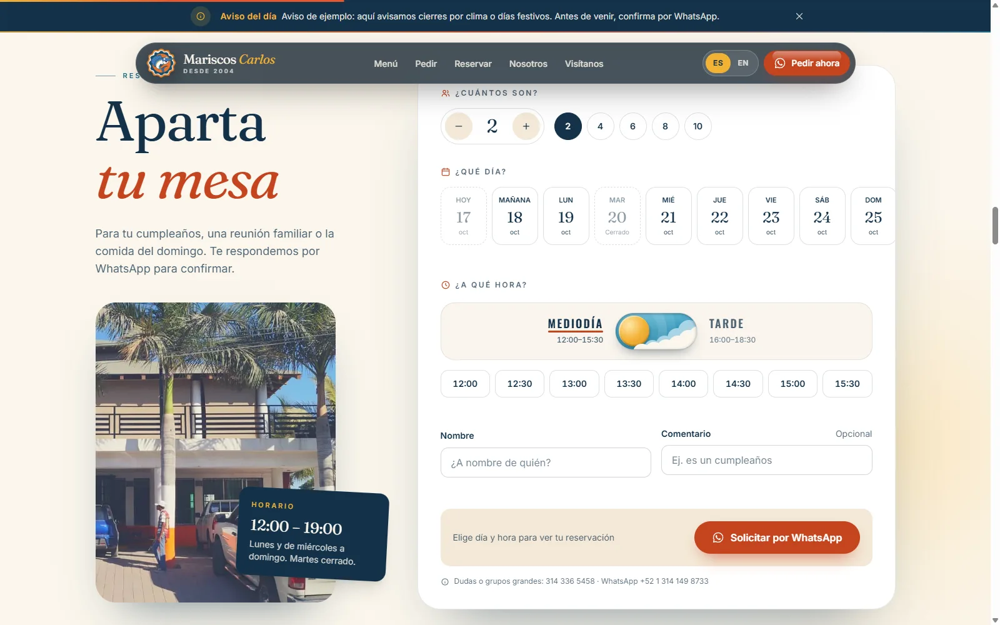
Aparta tu mesa
</td>
  </tr>
  <tr>
    <td colspan="2">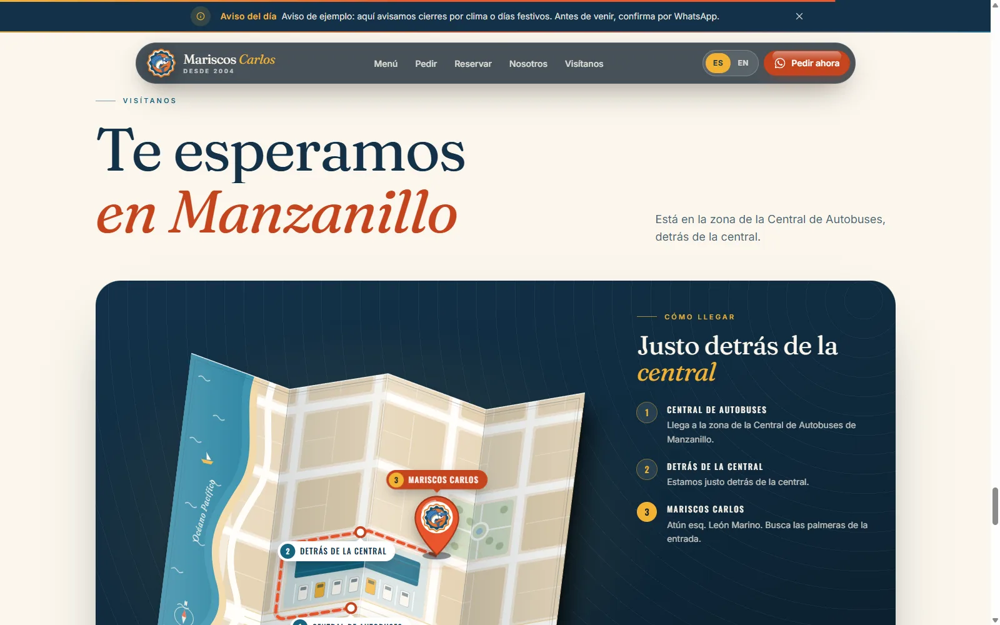
Te esperamos en Manzanillo
</td>
  </tr>
</table>

 

## ✦ En el celular

  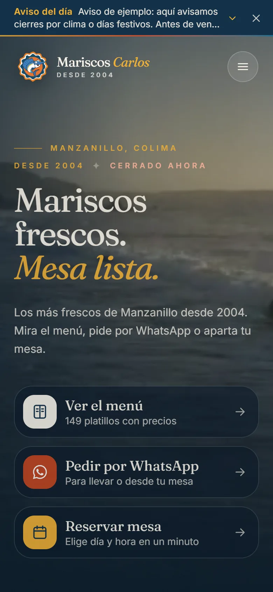
  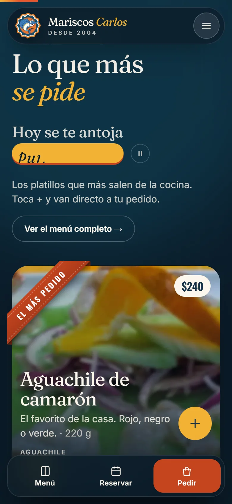
  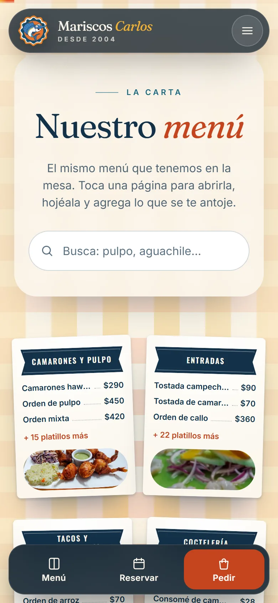
  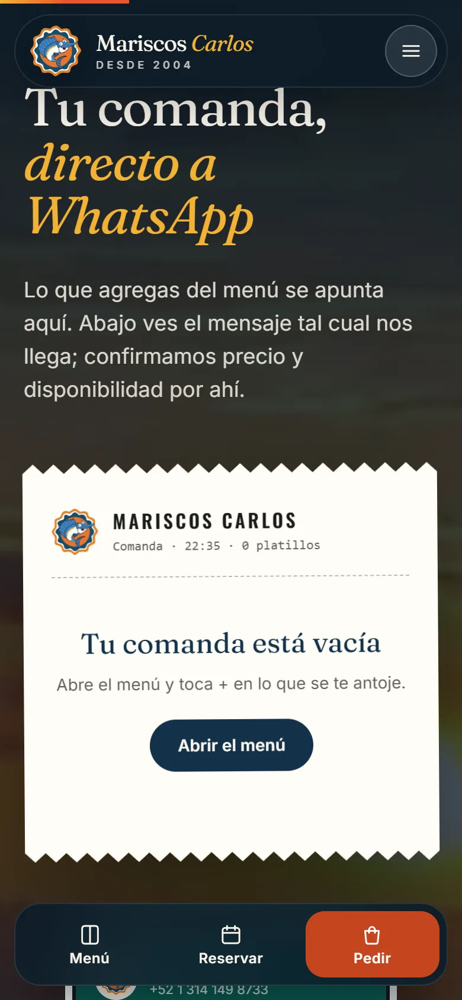

 

## ✦ Para el personal

<table>
  <tr>
    <td width="50%">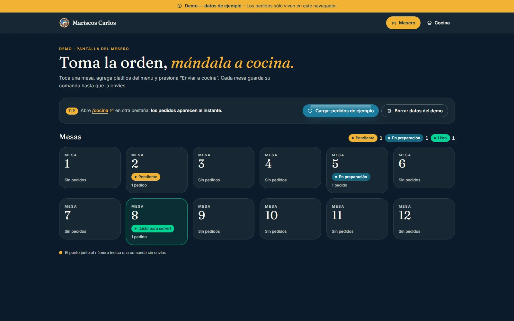
El mesero toma la orden y la manda a cocina
</td>
    <td width="50%">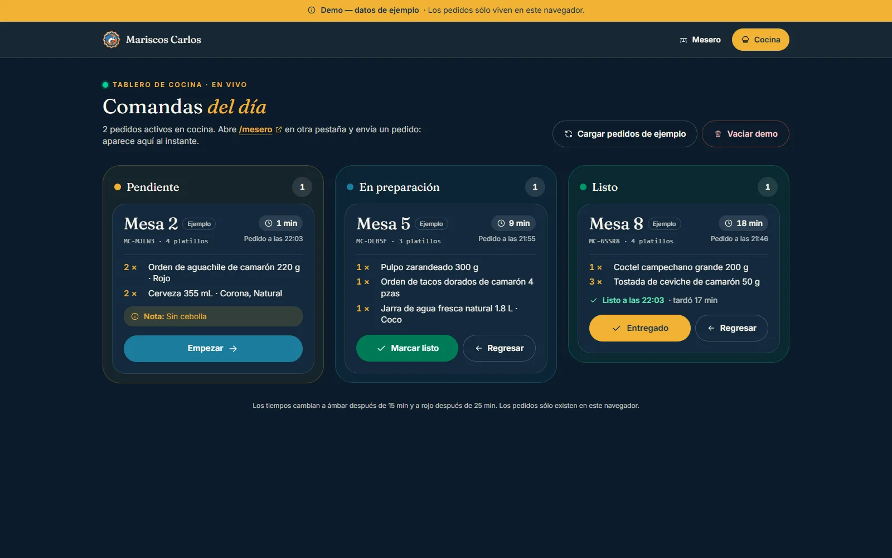
La cocina la ve al instante
</td>
  </tr>
  <tr>
    <td colspan="2">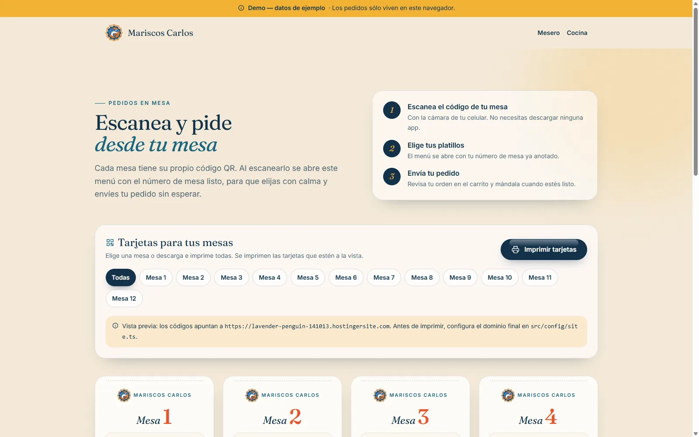
Un código QR por mesa, listo para imprimir
</td>
  </tr>
</table>

 

---

Diseñado y programado por <a href="https://carloramirez.dev"><b>Carlo Ramírez</b></a> · Manzanillo, Colima · 2026 
Fotos ilustrativas de Unsplash y videos de Mixkit.

